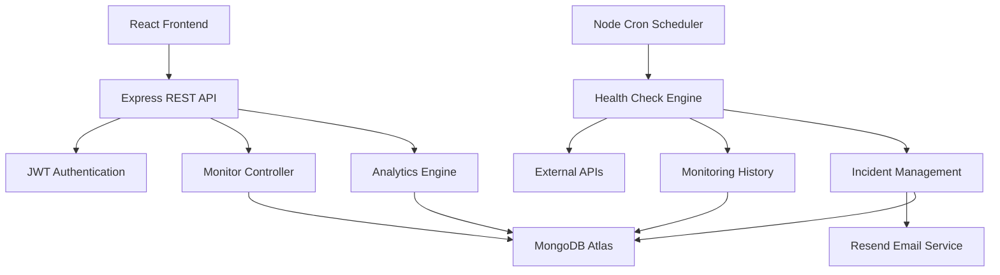
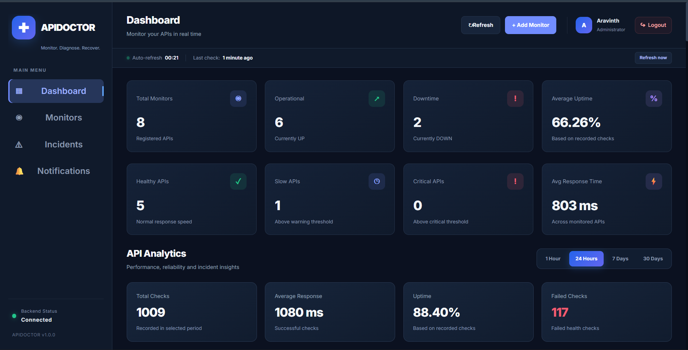
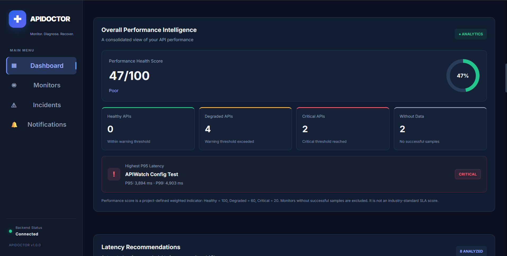
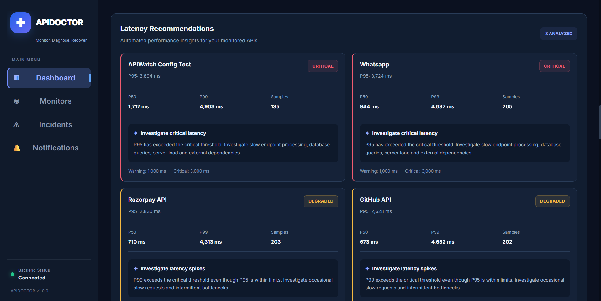
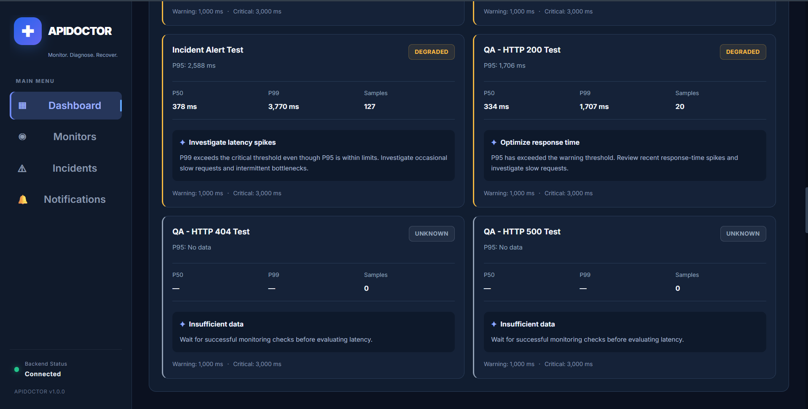
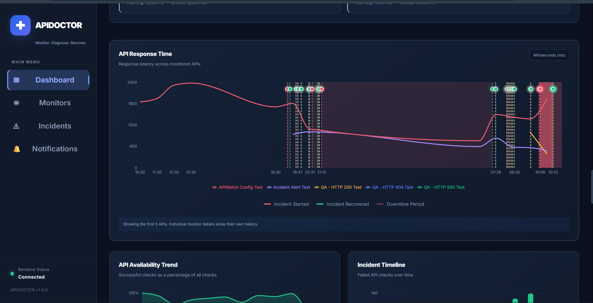
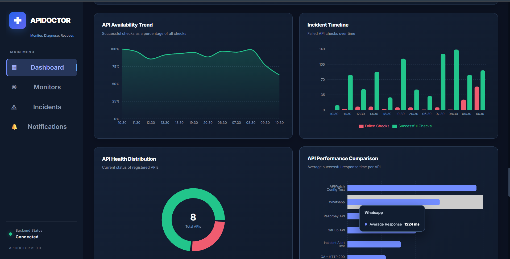
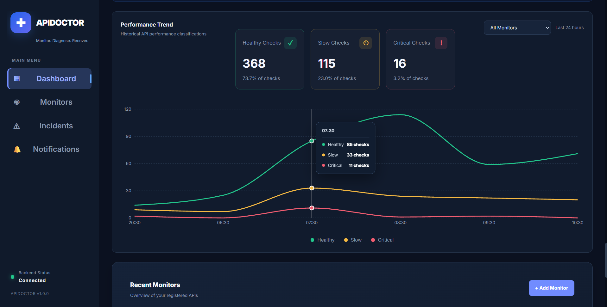
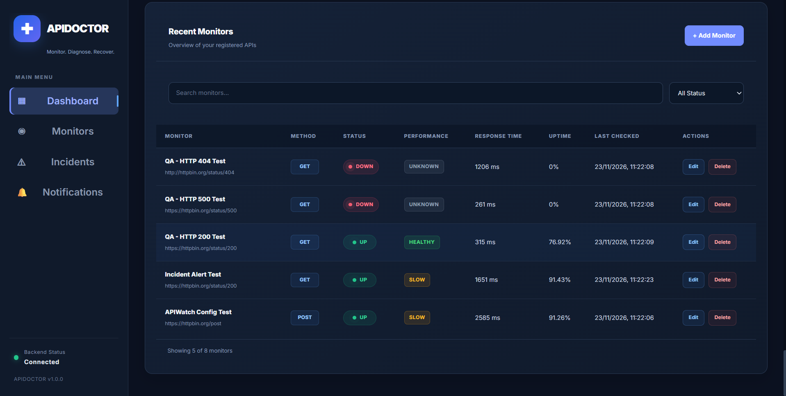

# APIDOCTOR 🚀
### Monitor. Diagnose. Recover.

APIDOCTOR is a full-stack API monitoring and performance intelligence platform built using the MERN stack. It helps developers monitor API availability, analyze response times, identify incidents, and track service performance through an interactive dashboard.

## ✨ Key Features

### 1. API Monitoring
- Create, update and delete API monitors.
- Support for GET, POST, PUT, PATCH and DELETE requests.
- Automated scheduled health checks.
- Configurable monitoring intervals.
- Custom request headers and request bodies.
- Expected HTTP status code validation.
- Response keyword validation.

### 2. Performance Intelligence
- Response-time tracking.
- P50, P95 and P99 latency analytics.
- Configurable warning and critical thresholds.
- API health classification:
  - HEALTHY
  - DEGRADED
  - CRITICAL
  - UNKNOWN
- Performance recommendations.
- Overall performance score.
- Historical performance trends.

### 3. Incident Management
- Automatic incident detection.
- Incident creation and resolution tracking.
- Failure count and downtime calculation.
- Incident timeline visualization.
- Email alerts when incidents occur.
- Recovery notifications when services return to normal.

### 4. Notification History
- Track incident alert and recovery emails.
- SENT and FAILED delivery-attempt records.
- Provider message ID tracking.
- Notification history and filtering.

### 5. Authentication and Security
- User registration and login.
- JWT-based authentication.
- Password hashing using bcrypt.
- Email verification.
- Forgot-password and password-reset workflows.
- Rate limiting for authentication endpoints.
- User-specific monitor and incident access.
- AES-256-GCM encryption for custom request headers.
- Secure password-reset and verification tokens.

## 🛠️ Tech Stack

| Category | Technologies |
|---|---|
| Frontend | React.js, Vite, CSS |
| Backend | Node.js, Express.js |
| Database | MongoDB Atlas, Mongoose |
| Authentication | JWT, bcryptjs |
| API Requests | Axios |
| Monitoring Scheduler | node-cron |
| Data Visualization | Recharts |
| Email Service | Resend |
| Encryption | AES-256-GCM |
| API Testing | Postman |
| Version Control | Git, GitHub |

## 🏗️ System Architecture



## 📂 Project Structure

```text
APIDOCTOR/
├── client/
│   └── src/
│       ├── api/
│       ├── components/
│       ├── context/
│       ├── pages/
│       ├── App.jsx
│       └── AppRouter.jsx
│
├── server/
│   ├── config/
│   ├── controllers/
│   ├── middleware/
│   ├── models/
│   ├── routes/
│   ├── scripts/
│   ├── services/
│   ├── utils/
│   └── server.js
│
└── .gitignore
```

## ⚙️ Installation and Setup

### Prerequisites
- Node.js
- npm
- MongoDB Atlas account
- Resend account (for email functionality)

### 1. Clone the repository

```bash
git clone https://github.com/Aravinth-Mahendran/APIDOCTOR.git
cd APIDOCTOR
```

### 2. Install frontend dependencies

```bash
cd client
npm install
```

### 3. Install backend dependencies

Open another terminal:

```bash
cd server
npm install
```

### 4. Configure environment variables

Create a `.env` file inside the `server` directory.

```env
PORT=5000
MONGO_URI=your_mongodb_connection_string
JWT_SECRET=your_jwt_secret
ENCRYPTION_KEY=your_32_byte_encryption_key

RESEND_API_KEY=your_resend_api_key
EMAIL_FROM=your_verified_sender
CLIENT_URL=http://localhost:5173
```

Never commit actual environment variables or API credentials to GitHub.

### 5. Start the backend

From the `server` directory, use the start command configured in `server/package.json`.

### 6. Start the frontend

From the `client` directory:

```bash
npm run dev
```

## 🖥️ Application Screenshots

### 1. Dashboard Overview


### 2. Performance Intelligence


### 3. Latency Recommendations


### 4. Recommendation Details


### 5. API Response Time and Incidents


### 6. Availability and Health Analytics


### 7. Performance Trend


### 8. Recent Monitors


Open the local Vite URL shown in your terminal.

## 📊 Performance Analytics

APIDOCTOR evaluates API latency using percentile-based metrics:

- **P50:** Median response time.
- **P95:** Response time below which 95% of recorded requests fall.
- **P99:** Response time below which 99% of recorded requests fall.

Performance classifications are based on configurable thresholds.

The overall performance score is a project-defined indicator based on API health classifications, not an external SLA certification.

## 🔐 Security

Security measures implemented include:

- Password hashing.
- JWT authentication and session invalidation.
- User-level resource ownership checks.
- Authentication rate limiting.
- Secure token hashing and expiry.
- Encrypted custom request headers.
- Protected backend routes.

## 🧪 Testing

The project has been tested using Postman, including:

- API availability and HTTP status validation.
- Authentication and authorization.
- Invalid JWT handling.
- User ownership isolation.
- Password-reset workflows.
- Rate-limiting behavior.
- Incident creation and recovery.
- Notification history.
- Response-time threshold validation.
- Performance classification and history persistence.

## 🎯 Project Objective

The objective of APIDOCTOR is to provide developers with a centralized platform to monitor API availability, understand performance degradation, identify service incidents and maintain visibility into API reliability.

## 👨‍💻 Author

**Aravinth Kumar**

GitHub: https://github.com/Aravinth-Mahendran

---

*APIDOCTOR — Monitor. Diagnose. Recover.*